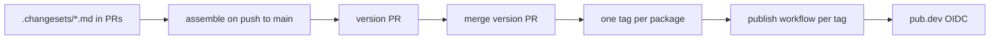

<div align="center">


# dart_changesets

_A changesets-style release engine for Dart — **GitHub Action + Dart CLI** — that turns small intent files into version PRs and per-tag pub.dev publish trains._

[](https://github.com/Arenukvern/dart_changesets/actions/workflows/release.yml)
[](https://github.com/Arenukvern/dart_changesets/actions/workflows/ci.yml)
[](https://pub.dev/packages/dart_changesets)
[](https://github.com/marketplace/actions/dart_changesets)
[](https://dart.dev)
[](LICENSE)
[](https://github.com/Arenukvern/dart_changesets#contributors-)

</div>

## Attribution

Design inspired by [changesets](https://github.com/changesets/changesets) and
its GitHub Action [@changesets/action](https://github.com/changesets/action)
(the original TypeScript implementation for npm monorepos). Differences are
ecosystem-driven: `pubspec.yaml` + `package:pub_semver` instead of
`package.json` semver, the dependency graph from pubspecs, and pub.dev's
automated publishing — which is **ref-gated per package tag**, so one tag
pushes one publish run (ordering emerges from dependency waits plus
skip-existing self-healing; see
[dart.dev automated publishing](https://dart.dev/tools/pub/automated-publishing)).

## Quick start (consumer repository)

The action is published on the
[GitHub Marketplace](https://github.com/marketplace/actions/dart_changesets) —
pin `@v1` for the current major.

**Before the first train:**

1. GitHub **Settings → Actions → General → Workflow permissions** → enable
   **Allow GitHub Actions to create and approve pull requests** (version PRs).
2. pub.dev **package → Admin → Automated publishing** → repository + tag pattern;
   if you publish without a PAT, also enable **Enable publishing from
   workflow_dispatch events** (`repository_dispatch` is rejected). Tag push
   events do not need that toggle.

3. **Two workflow files** (copy from [example/consumer-workflows](example/consumer-workflows)):
   `release.yml` (push to main; `actions/checkout` needs `fetch-depth: 0`) and
   `publish.yml` (per-tag pub.dev publish).
4. **Write an intent file** inside any PR:

   ```markdown
   ---
   'my_package': minor
   ---

   What changed, as changelog prose.
   ```

5. **Merge to main** → the action opens a `chore: version packages` PR
   (version bumps + dependent-constraint cascades + changelogs).
6. **Merge that PR** → one `<package>-v<version>` tag per release, one
   publish run per tag, ordered by dependency waits.

No conventional-commit discipline is required — release intent lives in
reviewed files, not commit messages.

**Required workflow permissions** in your release workflow: `contents:
write`, `pull-requests: write`, and `actions: write` — the last one
because the action starts publish runs via `gh workflow run` (workflow
dispatch creation). Without it, a version-PR merge pushes the tags but
fails to start the publish runs. Repair by re-running the failed release
RUN (a re-run checks out the original merge ref, so release mode
detects again; a fresh dispatch on a moved main head correctly does
nothing), or by dispatching the publish workflow per tag.

### pub.dev authorization: PAT optional, tag ref required

pub.dev always authorizes publishes when the workflow run is tied to a
**package tag ref** (`refType == tag`). A `workflow_dispatch` run on the
tag ref is allowed when the package admin enables **Enable publishing from
workflow_dispatch events** on pub.dev (Admin → Automated publishing). Tag
**push** events are always allowed once automated publishing is configured.

`GITHUB_TOKEN` tag pushes do not start other workflows, so the default
(no `token` input) path dispatches your `publish.yml` once per tag with
`--ref <package>-v<version>` and `execute=true`. Optional PAT
(`token: ${{ secrets.RELEASE_PLEASE_TOKEN }}`, Contents: write) makes tag
pushes start push-triggered publish legs instead — useful when you do not
enable workflow_dispatch on pub.dev, or when you want version-PR branch
pushes to run full CI:

```yaml
- uses: Arenukvern/dart_changesets@v1
  with:
    token: ${{ secrets.RELEASE_PLEASE_TOKEN }}
  env: { GITHUB_TOKEN: ${{ secrets.GITHUB_TOKEN }} }
```

Per package (owner-paced, web session): pub.dev → Admin → Automated
publishing → repository + tag pattern matching `tag_format`.

**No GitHub Actions `environment` is declared anywhere in this workflow — by
design** (dart-lang/core publishes the same way). The token's repository +
tag-pattern + pubspec-version checks are the authorization; repo-local
hardening belongs in a tag-protection ruleset (restrict who can push
`<package>-v*` tags), not in an environment object that silently
auto-creates in every consumer repo. Enabling pub.dev's optional
"Require GitHub Actions environment" checkbox on a package Admin page makes
that package's publish FAIL with an environment-mismatch error, because the
token carries no environment claim — leave the checkbox off, or add an
`environment` input to this workflow first if a consumer genuinely wants
reviewer-gated publishing. Decision record:
[doc/decisions/0001-no-github-environment-in-publish-path.md](doc/decisions/0001-no-github-environment-in-publish-path.md).

## Show your release train (consumer badge)

Two optional README badges for consumer repositories — train health and
attribution:

```markdown
[](https://github.com/OWNER/REPO/actions/workflows/release.yml)
[](https://github.com/Arenukvern/dart_changesets)
```

- The **release train** badge mirrors your `release.yml` (release workflow)
  latest run on the default branch. Red is the first visible signal the train
  broke — most often the workflow-permission setting above.
- The **release engine** badge is static attribution to this repository.
- If a repo avoids third-party image hosts, GitHub's native badge also works:
  `https://github.com/OWNER/REPO/actions/workflows/release.yml/badge.svg`
  (it shows the workflow's own display name).

Live example: [flutter-mcp-toolkit](https://github.com/Arenukvern/mcp_flutter)
carries both in its README badge row.

## How it works

```yaml
# The whole main-side wiring in a consumer repo:
- uses: Arenukvern/dart_changesets@v1
  env: { GITHUB_TOKEN: ${{ secrets.GITHUB_TOKEN }} }
  # permissions on the job: contents + pull-requests + actions: write
```



- **Assemble mode**: pending `.changesets/*.md` intent files → the engine
  computes the train (declared bumps + transitive dependents whose caret
  constraints no longer admit the new versions, via `package:pub_semver`) →
  applies it onto the version branch → opens/updates the version PR.
- **Release mode** (the push that merged the version PR): the train artifact
  committed by the PR lists one tag per release → the action pushes each tag
  and dispatches the consumer's `publish.yml` once per tag.
- **Publish workflow**: installs the engine via `dart pub global activate`,
  decides workspace-aware whether the run needs Flutter (`pub publish`
  inside a pub-workspace member resolves the whole workspace, so any
  `sdk: flutter` member makes the SDK required — pure-Dart repositories
  never install it), installs the SDK from the stable channel (latest by
  default; cache enabled) when needed, then
  runs static checks → skip-existing → typed BOOTSTRAP gate for never-published
  packages → dependency wait (15 minutes by default, progress logged per
  poll; `--dependency-wait-minutes` / the reusable workflow's
  `dependency-wait-minutes` input configure it, and
  `--skip-dependency-gate` / the `skip-dependency-gate` input publish as-is
  (pub.dev upload validation stays the arbiter) — this is how concurrent
  per-tag runs converge on a train without manual re-dispatches) → strict
  dry-run → `pub publish --force` (OIDC) → wait for pub.dev visibility.

## Repository setup

| Layout | `changesets.yaml` |
| --- | --- |
| **Single package** at repo root | `root_package: true` (or omit `packages_dir` / `pkgs` — the engine discovers the root pubspec) |
| **Monorepo** (`pkgs/*` or `packages/*`) | default `packages_dir: pkgs`; uses `packages/` when `pkgs/` is absent |
| **Dart pub workspace** | `workspace:` in root `pubspec.yaml` (preferred; globs supported) |

## Configuration

`changesets.yaml` at the repository root (all keys optional):

| Key | Default | Purpose |
| --- | --- | --- |
| `packages_dir` | `pkgs` | One-level scan when no `workspace:` declaration |
| `root_package` | `false` | Include the repository root `pubspec.yaml` as a package |
| `dependent_bump` | `patch` | Bump for publishable dependents with rewritten constraints (`patch` or `minor`) |
| `ignore` | `[]` | Package names never released (in addition to `publish_to: none`) |
| `tag_format` | `{package}-v{version}` | Per-package release tags (match pub.dev tag pattern) |
| `product_tag` | — | One package that also gets a product-shaped tag + GitHub release at merge |
| `version_files` | — | Non-pubspec version strings bumped with each release |

Example:

```yaml
packages_dir: pkgs
root_package: false
dependent_bump: patch
ignore:
  - internal_tools
tag_format: '{package}-v{version}'
product_tag:
  package: my_app
  format: 'v{version}'
version_files:
  my_app:
    - path: VERSION
      pattern: '{version}'
```

Packages marked `publish_to: none` are private automatically and never
released; the doctor gate fails when a publishable package depends on one.

### CLI commands beyond `version`

- `dart_changesets product-release` — release mode prints `tag=`, `package=`,
  `version=` for GitHub releases; publish mode maps a package tag to the
  product tag for downstream dispatch.
- `dart_changesets release-notes --package NAME --version X.Y.Z` — changelog
  section text for GitHub release bodies.

Workspace discovery order: root `workspace:` list → `packages_dir` (with
`packages/` fallback) → implicit root pubspec when no package directory exists.

### Product tag → GitHub release → binaries

When `product_tag` is configured and that package is in the train, the
version-PR merge creates `v{version}` on the merge commit and a GitHub
release whose notes are that package's new changelog section. Downstream
builds (binaries, registry) must start AFTER the product package's publish
leg succeeds — at merge time the new dependency versions are not on pub.dev
yet, so a build resolving them fails. Two supported wirings:

```yaml
# Option A (recommended): chain in your per-tag workflow — ordering is
# guaranteed by needs:, zero extra engine config.
jobs:
  publish:
    uses: Arenukvern/dart_changesets/.github/workflows/publish.yml@v1
    with: { tag: ${{ github.event.inputs.tag || github.ref_name }}, execute: true }
  binaries:
    needs: publish
    if: startsWith(github.event.inputs.tag || github.ref_name, 'flutter_mcp_toolkit_server-v')
    uses: ./.github/workflows/release.yml
    with: { release_tag: ${{ github.event.inputs.tag || github.ref_name }} }

# Option B: let the reusable publish workflow dispatch for you (fires only
# for the product package's tag, only after publish succeeded):
#   with:
#     product-dispatch-workflow: release.yml
#     product-dispatch-input: release_tag
```

### Token

The action's `token` input (default `github.token`) is used for every
branch push, PR create/edit, tag push, release creation, and dispatch.
Pushes made with `GITHUB_TOKEN` trigger no workflows — so the version PR
runs no CI by default. A PAT (or App token) makes the version PR run full
CI; the action overrides checkout's persisted credential so pushes really
ride that token.

## CLI

One-off, no install — Dart 3.12+ runs any pub.dev executable directly:

```bash
dart run dart_changesets@ status   # pending intents → planned releases
```

Or install globally:

```bash
dart pub global activate dart_changesets
dart_changesets add                # interactive intent file
dart_changesets status             # pending intents → planned releases
dart_changesets version [--check]  # apply (or detect) the version train
dart_changesets doctor [--no-network]  # gates + pub.dev census
dart_changesets tags               # tags for the pending train (JSON)
dart_changesets runner --tag <pkg>-v<semver>   # dart | flutter
dart_changesets publish-tag --tag <pkg>-v<semver> [--execute] [--skip-existing] [--dependency-wait-minutes 15] [--skip-dependency-gate]
```

## Bootstrap (first publish of a new package)

pub.dev cannot automate a package's first release:

1. `dart pub publish` (or `flutter pub publish`) from the package directory —
   sign in with the uploader account in the browser.
2. On pub.dev: package → Admin → **Automated publishing** → enable for the
   consumer repository with tag pattern `<package>-v{{version}}`.
3. Re-run the publish (skip-existing keeps it idempotent).

New-package rate limit is ~12/day (4 in a burst) — spread first publishes
across days.

## Troubleshooting

| Symptom | Likely cause | Fix |
| --- | --- | --- |
| Version PR branch pushed, no PR opened | **Allow GitHub Actions to create and approve pull requests** off | Settings → Actions → General → Workflow permissions |
| Tags pushed, publish never runs | Missing `actions: write` on the release job | Add to `permissions:` in `release.yml`; re-run failed release or dispatch `publish.yml` per tag |
| Version-PR CI does not run | Pushes use `GITHUB_TOKEN` | Optional PAT via `token:` input |
| `gh pr edit` / GraphQL scope errors on assemble | PAT missing `read:org` (only affects legacy paths) | Upstream action uses REST `PATCH pulls`; update `@v1` |
| Publish waits then times out | Dependency floor not visible on pub.dev yet | Wait or raise `dependency-wait-minutes`; recovery: `skip-dependency-gate` |
| Tag exists, version still on pub.dev old | First publish or failed leg | First publish is always manual; re-dispatch publish with skip-existing |
| `FAIL: release drift detected` | Pubspec **behind** a release tag (out of sync with pub.dev) | Restore pubspec to ≥ tagged version, or fix mistaken tags. Pubspec **ahead** of tags (unreleased merge) is OK — the next train bumps from the pubspec |

## Action ref (`@v1`) and engine install

Consumers pin `Arenukvern/dart_changesets@v1`. The composite action installs
the CLI from **`GITHUB_ACTION_PATH`** (the checked-out action tree), not from
the consumer’s `GITHUB_SHA`.

Reusable `publish.yml` installs from **`job.workflow_sha`** / **`job.workflow_repository`**
in the called workflow repository (`github.job` is the **current job’s id string**, e.g.
`publish`, not the caller or workflow ref — do not use for engine install).
Unavailable on GHES → warning and `main` fallback. Override with `engine-ref`
when pinning a specific tag. Checkout must use **`fetch-depth: 0`** so release
mode can read tags and train history.

Only this repository sets `major-action-ref: v1` on self-release to move the
`v1` pointer after each version-PR merge (`git ls-remote` + `--force-with-lease`
on the tag ref). That step is **warn-only** on failure. The default
`GITHUB_TOKEN` cannot receive `workflows: write` — use a **PAT or GitHub App
token** with `workflows` permission when tag moves must succeed across commits
that touch workflow files.

When `product_tag` is configured, the merge can also create product-shaped tags
and GitHub releases — optional for consumers.

## This repository releases itself

The action and the reusable publish workflow run this repo's own train
(`.github/workflows/release.yml` + `self_publish.yml`). The engine package
lives at the repository root; write an intent file to release it.

This repo releases like any consumer: add a patch/minor/major intent under
`.changesets/`, merge the version PR the assembler opens, and the self-release
workflow tags and publishes each package. **1.0.1** is the first **1.x** on
pub.dev (the `dart_changesets-v1.0.0` tag exists on GitHub but never published
because of a layout warning, fixed in 1.0.1). What ships next is whatever
pending intents say — not hardcoded here.

## ✨ Contributors

Huge thanks to all contributors for making this project better!

This roster is maintained with [all-contributors](https://allcontributors.org/).
To add someone, update [`.all-contributorsrc`](.all-contributorsrc) and
regenerate the README table, or comment on a pull request:

`@all-contributors please add @<login> for code`

More detail: [CONTRIBUTING.md](CONTRIBUTING.md#contributor-credit).

<!-- https://allcontributors.org/docs/en/bot/usage -->

<!-- ALL-CONTRIBUTORS-LIST:START - Do not remove or modify this section -->
<!-- prettier-ignore-start -->
<!-- markdownlint-disable -->
<table>
  <tbody>
    <tr>
      <td align="center" valign="top" width="14.28%"><a href="https://xsoulspace.dev"><br /><sub><b>Anton Malofeev</b></sub></a><br /><a href="https://github.com/Arenukvern/dart_changesets/commits?author=Arenukvern" title="Code">💻</a> <a href="https://github.com/Arenukvern/dart_changesets/commits?author=Arenukvern" title="Documentation">📖</a> <a href="#maintenance-Arenukvern" title="Maintenance">🚧</a> <a href="#infra-Arenukvern" title="Infrastructure (Hosting, Build-Tools, etc)">🚇</a></td>
    </tr>
  </tbody>
</table>

<!-- markdownlint-restore -->
<!-- prettier-ignore-end -->

<!-- ALL-CONTRIBUTORS-LIST:END -->

## Documentation

- [doc/DESIGN_FAQ.md](doc/DESIGN_FAQ.md) — why the engine is shaped this way (intents, per-tag publish, OIDC, dependency wait)
- [doc/DX_FAQ.md](doc/DX_FAQ.md) — how to develop, consume, and troubleshoot trains
- [doc/decisions/](doc/decisions/) — ADRs for cross-cutting decisions

## Contributing & community

- [CONTRIBUTING.md](CONTRIBUTING.md) — setup, validation, conventions, PR checklist
- [Code of Conduct](CODE_OF_CONDUCT.md)
- [SECURITY.md](SECURITY.md) — private vulnerability reporting
- [Discussions](https://github.com/Arenukvern/dart_changesets/discussions) — usage questions

Released under the [MIT License](LICENSE).
